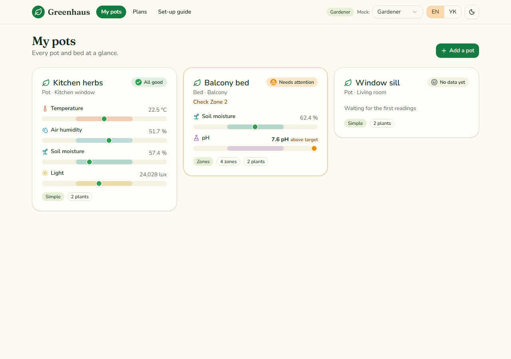
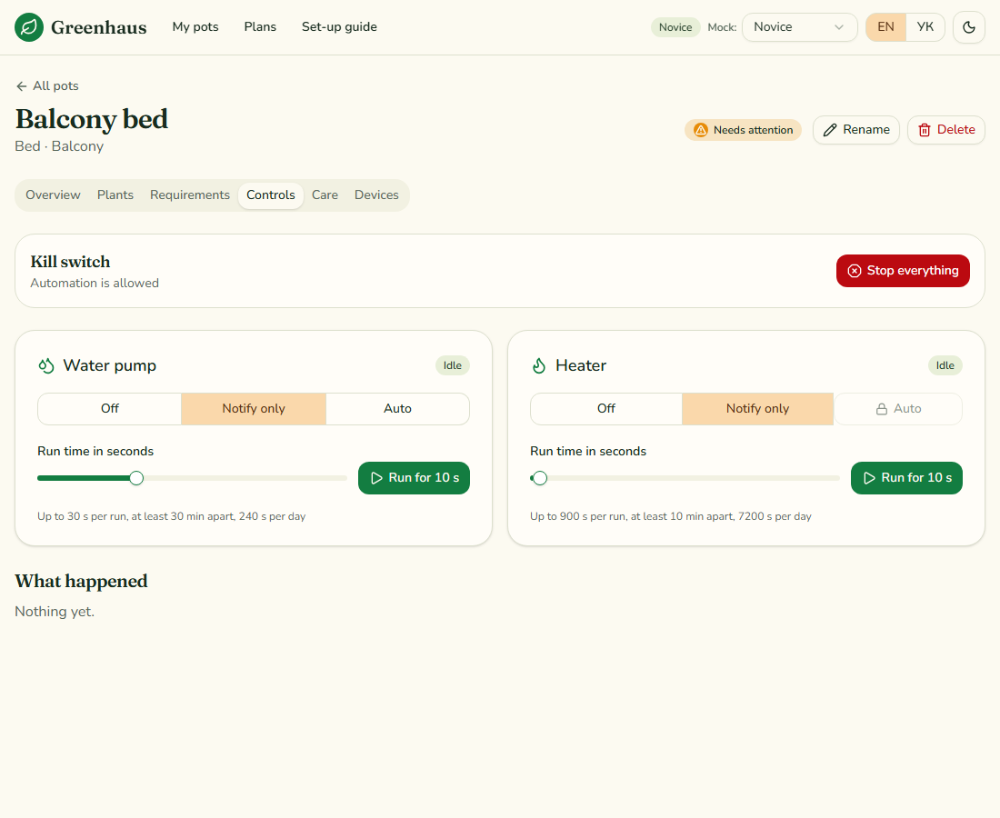
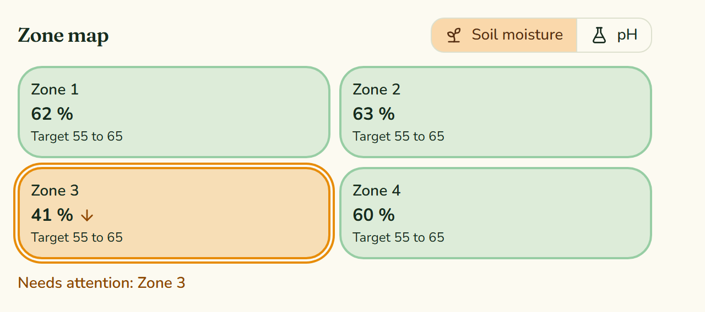
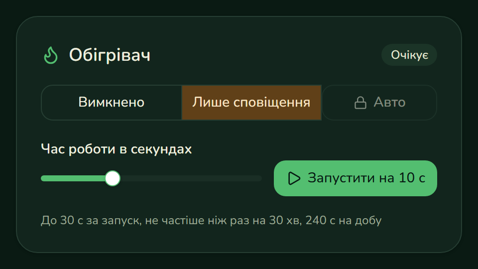
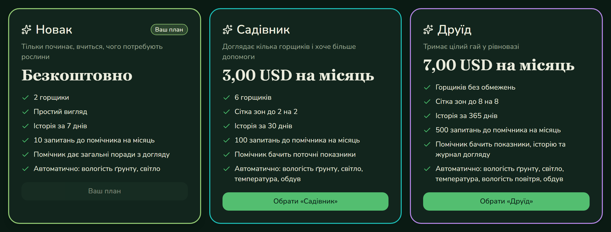

# Greenhaus

[](https://github.com/sskobalskyi/greenhaus/actions/workflows/ci.yml)


> Working name. Not affiliated with any existing Greenhaus business, and the name is not licensed under the MIT licence of this repository.

Smart pots for plants: sensors and relays in a pot controller, a shop to buy them, a QR scan to claim them, live monitoring and gentle automation, and an assistant that knows your plants. Greenhaus is the **product layer** that composes three generic platforms:

| Platform | Role | Repository |
| --- | --- | --- |
| Orderflow | Marketplace: catalog, orders, payment, shipping | `orderflow` |
| Pulse | Device platform: telemetry, alerts, commands | `pulse` |
| Docs-Brain | Knowledge and AI: retrieval, assistant | `docs-brain` |
| Observatory | Observability lab: traces, metrics, dashboards, load tests | `observatory` |

Greenhaus owns everything that is specific to plants: users and tiers, pots, zones, plants, requirements, automation policy, care tasks, subscriptions and achievements. The platforms stay generic and know nothing about pots ([ADR 0001](docs/adr/0001-product-layer-over-generic-platforms.md)).

## Status

**Alpha.** Contracts and the mock can change without notice, and there is no product code yet. Work lands through pull requests.

The first stream is the contract layer: HTTP APIs in OpenAPI, events and MQTT topics in AsyncAPI, and a mock backend that serves them so the UI and the services can be built in parallel. The Greenhaus API mock is running and contract-tested. The billing and Pulse mocks are next.

## Layout

```
contracts/openapi/     HTTP contracts: Greenhaus API, billing API, Pulse device API
contracts/asyncapi/    integration events (RabbitMQ) and device topics (MQTT)
mock-server/           .NET mock of the Greenhaus API with contract tests ([details](mock-server/README.md))
packages/ui/           design system and Storybook on shadcn/ui ([details](packages/ui/README.md))
apps/web/              the product app ([details](apps/web/README.md))
data/                  curated data, such as the species catalog
docs/adr/              architecture decision records
```

## Contracts

Contract-first: the specifications are the source of truth, and both mocks and real services are checked against them.

| Contract | File |
| --- | --- |
| Greenhaus API: profile, tiers, pots, zones, plants, requirements, controls, care tasks, claim | [`greenhaus-api.yaml`](contracts/openapi/greenhaus-api.yaml) |
| Billing API: plans, subscription, purchase grants | [`billing-api.yaml`](contracts/openapi/billing-api.yaml) |
| Pulse device API additions: devices, channels, capabilities, rules, commands, claim | [`pulse-device-api.yaml`](contracts/openapi/pulse-device-api.yaml) |
| Integration events between projects | [`integration-events.yaml`](contracts/asyncapi/integration-events.yaml) |
| Device topics and payloads over MQTT | [`device-mqtt.yaml`](contracts/asyncapi/device-mqtt.yaml) |

Validate locally:

```powershell
npx --yes @redocly/cli lint contracts/openapi/*.yaml
npx --yes @asyncapi/cli validate contracts/asyncapi/integration-events.yaml
npx --yes @asyncapi/cli validate contracts/asyncapi/device-mqtt.yaml
```

## The app

React app for pots, plants, controls, plans and the QR claim flow, in English and Ukrainian, light and dark. It runs against the mock backend today.





```powershell
npm install                    # installs the web workspace
docker compose up -d mock      # the mock backend on :8090
npm run dev -w @greenhaus/web  # http://localhost:5174
npm run e2e -w @greenhaus/web  # 38 end-to-end tests with an accessibility scan of every page
```

See [apps/web](apps/web/README.md) and [ADR 0002](docs/adr/0002-web-workspace-and-design-system-from-source.md).

## Design system

A shadcn/ui based component library with a Storybook, in English and Ukrainian, light and dark. Every story runs as a browser test with an accessibility check, and live-data stories read from the mock backend.

| | |
| --- | --- |
|  |  |



See [packages/ui](packages/ui/README.md).

## Run the mock

```powershell
docker compose up --build   # http://localhost:8090/api/greenhaus/v1
dotnet test mock-server/GreenhausMock.slnx   # checks every response against the contract
```

## Run the real service

`src/Greenhaus.Api` is the real implementation of the same contract: ASP.NET Core on PostgreSQL (EF Core), with the tier rules in `src/Greenhaus.Domain`. See [ADR 3](docs/adr/0003-api-service.md).

```powershell
docker compose --profile real up --build api   # http://localhost:8091/api/greenhaus/v1
dotnet test tests/Greenhaus.Domain.Tests
dotnet test tests/Greenhaus.Api.Tests          # real PostgreSQL through Testcontainers, every response checked against the contract
```

Locally the service runs with `Auth__Mode=Development`, which trusts an `X-User-Id` header. Production-style use validates Keycloak tokens (`Auth__Authority`, `Auth__Audience`). Linking controllers, live readings and the outbox relay arrive with the Pulse and RabbitMQ integration.

## Roadmap


Done: contracts, the mock backend (Greenhaus, billing, Pulse), the design system and the product app, all contract-tested and covered by end-to-end tests.

Waiting for the real services, which the app will use through the same contracts:

- **Greenhaus API:** pots, plants, zones, requirements, tiers, controls and care run on PostgreSQL with sign-in through Keycloak. Still to come: the Pulse client (claims, readings, commands, alert rules) and the RabbitMQ relay and consumer for the outbox, `entitlement.changed.v1` and `device.claimed.v1`.
- **Pulse:** live readings and commands over MQTT (the app polls every ten seconds today), and device allocation from order events.
- **Docs-Brain:** an assistant panel scoped to a pot, with data access by tier.
- **Orderflow:** Greenhaus kit products in its catalog (through its `Catalog:SeedFile`), and consuming `device.claimed.v1` to show an order as activated.
- **Later:** achievements (last, by decision), the real billing service, an ESP32 sketch for the same MQTT topics.
## Licence

MIT, see [LICENSE](LICENSE).
