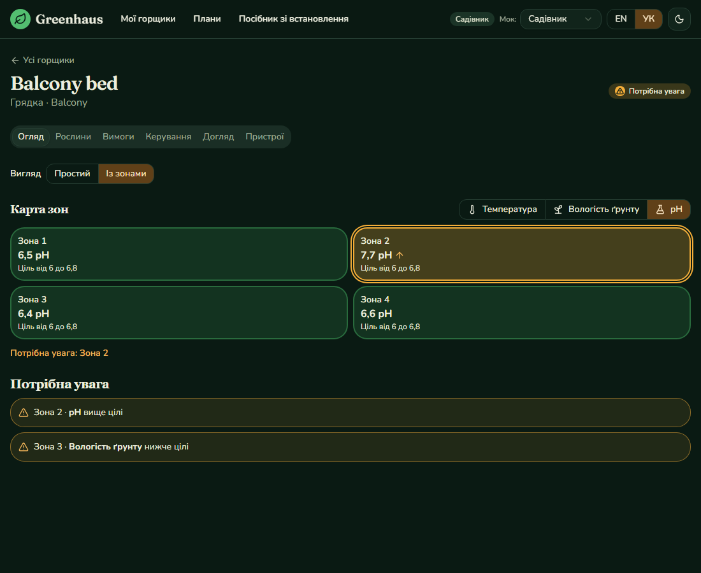

# Greenhaus web app

The product UI: pots at a glance, a pot page per pot, plans, the QR claim flow and a set-up guide. React 19, React Router, TanStack Query and the design system from `packages/ui`, in English and Ukrainian, light and dark. It talks only to the Greenhaus API contract, so today it runs against the mock backend.


## Run

```powershell
npm install                    # at the repository root, installs the whole workspace
docker compose up -d mock      # the mock backend on http://localhost:8090
npm run dev -w @greenhaus/web  # http://localhost:5174
```

A small "Mock" selector in the header lets you act as the Novice, Gardener or Druid tier to see limits and upsells. It exists only while talking to the mock and can be turned off with `VITE_MOCK=false`.

| Setting | Default | Meaning |
| --- | --- | --- |
| `VITE_API_BASE` | `http://localhost:8090/api/greenhaus/v1` | The Greenhaus API |
| `VITE_BILLING_BASE` | `http://localhost:8090/api/billing/v1` | The billing API: prices, subscribing and cancelling. Set it to `http://localhost:8092/api/billing/v1` for the real billing service |
| `VITE_OIDC_AUTHORITY` | unset | Turns sign-in on, for example `http://localhost:8181/realms/greenhaus`. Unset, the app has no login (mock mode) |
| `VITE_OIDC_CLIENT_ID` | `greenhaus-web` | The public Keycloak client of the app |
| `VITE_SHOP_URL` | `http://localhost:5173` | The marketplace (Orderflow), for "Open the shop" |

## Pages

| Page | What it does |
| --- | --- |
| My pots | Every pot as a card. A pot in the zones view names its worst zone. Adding a pot past the plan limit opens an upsell with the tier that unlocks it |
| A pot | Tabs for the overview (live readings, or the zone map), plants (with a conflict warning when plants disagree), requirements (editable ranges per metric, switch a metric off, start from what the plants suggest), controls, care tasks (including your own) and linked controllers. A pot can be renamed or deleted |
| Controls | Mode per actuator, manual run, safety limits, a kill switch and the audit log of what the automation did. A missing thermal cutoff is explained, and a missing calibration opens the calibration form (dry and wet readings, for one sensor or all of them) |
| Assistant | A tab of every pot: ask a question and read the answer as it is written (server-sent events read with `fetch`, because the request is a POST with a token), with the sources it may cite, the month's questions used and a note on what the plan lets the assistant see (none, current readings, or history and care log). When the answer is only passages, or nothing was found, it says so and that the question did not count. A refusal for the quota offers the plan that has more, and an assistant that is down is explained calmly with a retry. Against the mock the text is canned, the quota rules are the real ones |
| Notifications | A bell in the header with the number of unread notifications, which opens a list newest first: an alert on a pot (with the zone), a controller offline or back, a care task that is due, a plan that was lowered or a grant at risk. The texts are written in the app from a kind and its facts, in English and Ukrainian. Opening one marks it read and goes to its pot, and "mark all as read" clears the count. The app looks for new ones every 30 seconds while signed in |
| Plans | The three tiers with their limits and prices, the current one marked. Choosing a plan subscribes through the billing mock (a demo switch simulates a declined card), the subscription can be cancelled, and a banner explains a purchase grant that is at risk |
| Claim | The page the QR code opens: shows the device, asks for a pot and links it. Unshipped, expired, wrong and already-claimed codes get a clear explanation |
| Set-up guide | The ready kit, a build-it-yourself parts list, the QR steps and the safety advice about overflow, siphoning and heaters |



## Tests

```powershell
docker compose up -d mock
npm run e2e -w @greenhaus/web
```

38 Playwright tests drive the real app against the mock: the overview, the zones view and metric switch, plan limits and the upsell, the heater guard and the kill switch, plants and care, plans, editing requirements, the calibration flow, checkout, the whole QR claim flow, the language switch, and an **axe accessibility scan of every page in light English and dark Ukrainian**. The mock is reset before each test.

Screenshots for the READMEs are produced by `SCREENSHOTS=1 npx playwright test screenshots`.

## Known gaps

- No real sign-in yet. The mock does not check tokens, and Keycloak arrives with the real Greenhaus API.
- Live updates poll every ten seconds. SignalR from Pulse comes with the real device platform.
