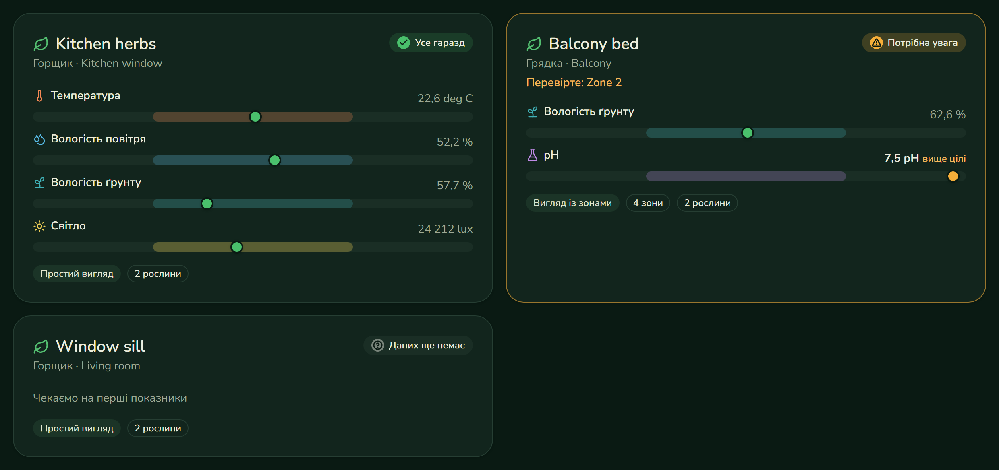

# Greenhaus design system

shadcn/ui components, Greenhaus components built on them, and a Storybook to develop, document and test everything. Free and open-source tools only, and nothing is published: Storybook runs locally.

The vibe is deliberately not an enterprise dashboard: warm paper, leaf greens and earthy accents, a rounded serif for headings and a friendly sans for text, light and dark themes, and plain language.



## Run

```powershell
cd packages/ui
npm install
npm run storybook          # http://localhost:6006
docker compose up mock     # from the repository root, serves the live-data stories
```

| Script | What it does |
| --- | --- |
| `npm run storybook` | Storybook with a language switch (English, Ukrainian), a theme switch (light, dark) and the accessibility panel |
| `npm test` | Runs every story in a real browser (Playwright). Interaction tests (`play` functions) and the accessibility check both run, and a violation fails the test |
| `npm run typecheck`, `npm run lint` | TypeScript and oxlint |
| `npm run api:types` | Regenerates `src/api/schema.d.ts` from `contracts/openapi/greenhaus-api.yaml` |
| `npm run build-storybook` | Static Storybook in `storybook-static/` |
| `npm run screenshots` | Captures the key stories in light English and dark Ukrainian into `docs/screenshots/ui/` |

## Stack

Vite, React 19, TypeScript, Tailwind CSS 4, shadcn/ui (Radix), lucide icons, i18next with react-i18next, fonts from `@fontsource` (no CDN), Storybook 10 with the docs, a11y, themes and vitest addons.

## Components

| Component | What it shows |
| --- | --- |
| `StatusChip` | All good, needs attention, sensor offline, no data. Shape and colour together |
| `RequirementBand` | One reading against the pot's target range. A meter with an accessible value text |
| `PotCard` | A pot at a glance. With zones it names the worst zone and shows its readings |
| `PotZoneMap` | A heatmap of one metric across the zones of a pot or bed, with a metric picker |
| `ActuatorControl` | Mode (`Off`, `Notify only`, `Auto`), manual run and safety limits. Auto is locked by tier and says which tier unlocks it |
| `TierCard` | A subscription tier with its limits in plain words |
| `CareTaskItem` | A care task with its origin, such as a pH sensor suggestion |
| `LanguageSwitcher`, `ThemeToggle` | Language and theme |

Base components in `src/components/ui/` come from shadcn and are owned by this repository.

## Design decisions

- **Never an average.** A pot with several sensors is shown per zone, and the pot state is its worst zone, named. `PotCard` and `PotZoneMap` have no way to display a blended value.
- **Safety is always visible.** Safety limits are shown on every actuator, whatever the tier.
- **State is not colour alone.** Every status has an icon and a word, and each metric has its own icon.
- **Data comes from the contract.** Types are generated from the OpenAPI document. Stories named "From mock" load real data from the mock backend, so component shapes cannot drift from the API. The typed builders in `src/stories/args.ts` only describe component states (a dry zone, a locked tier), they are not API mocks.
- **Accessibility is a test.** The a11y addon runs in `error` mode, so a contrast or labelling violation fails `npm test`. Every component also has a dark Ukrainian story, so contrast and longer words are checked in both themes. The first run found real problems (slider without a name, low contrast for attention text and tier badges, a meter without a value), all fixed.
- **Translations are data.** Strings live in `src/i18n/locales/en.json` and `uk.json`, with Ukrainian plural forms.

## Known gaps

- Default zone labels ("Zone 3") come from the API in English. They should be localized on the client, so the contract should allow a missing label. To be raised as a small contract PR.
- Currency is passed in as data. A billing contract field for the display currency is not defined yet.
- No visual regression run in CI yet. Screenshots are generated, not compared.
